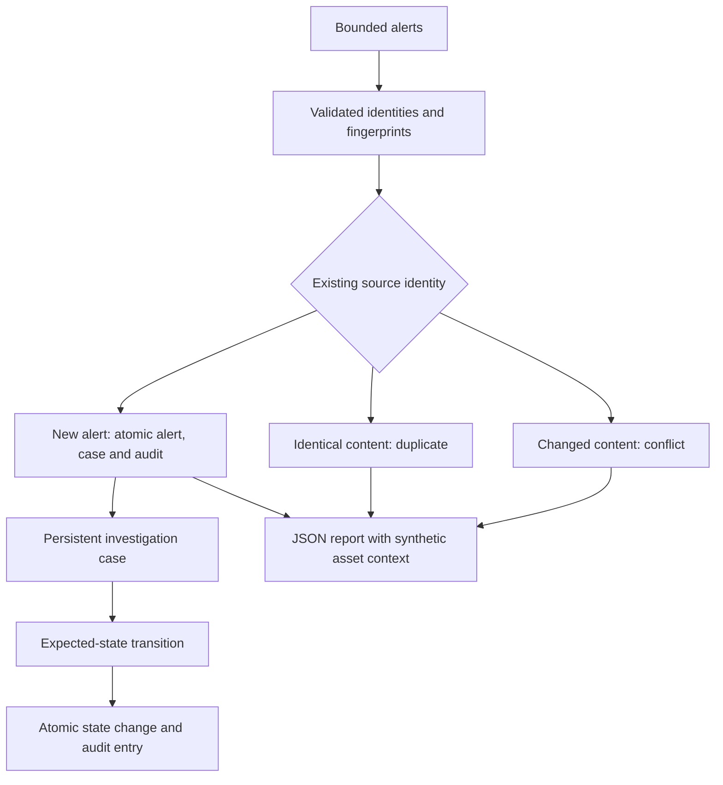

# SOC Triage Orchestrator

Auditable offline SOC triage with idempotent alert ingestion,
persistent investigation cases and transactional workflow history.

An educational defensive automation project. It organizes supplied alerts;
it does not determine whether an incident is real.

## Features

- Strict bounded alert parsing and UTC normalization.
- Source identity separated from normalized content fingerprints.
- Idempotent imports across process restarts.
- Explicit conflicts when an identity is reused with different content.
- Atomic creation of alert, case and initial audit entry.
- Deterministic severity-based priority with retained policy version.
- Synthetic local asset context with explicit missing lookup results.
- Reviewed workflow: new → investigating → closed.
- Expected-state checks against stale transition commands.
- Transactional state changes and audit entries.
- CLI import, case inspection and workflow transition commands.

## Installation

Use Python 3.12 or newer on Linux, from the repository root.

```bash
python3 -m venv .venv
source .venv/bin/activate
python -m pip install -r requirements-dev.lock
python -m pip install --no-build-isolation --no-deps .
python -m pip check
```

The application has no third-party runtime dependencies.
Development versions are pinned without package artifact hashes.

## Import Alerts

```bash
mkdir -p reports
demo_directory=$(mktemp -d reports/triage-demo-XXXXXX)

soc-triage --db "$demo_directory/cases.sqlite" ingest \
  --input data/synthetic/alerts-demo.jsonl \
  --inventory config/assets-demo.json \
  --at "2026-01-01T00:00:00+00:00"
```

The bundled input deliberately includes a content conflict.
Expected exit code: 1.

| Exit code | Meaning |
| --- | --- |
| 0 | Successful operation without ingestion conflicts |
| 1 | Import completed with at least one conflict |
| 2 | Usage, input, storage or execution error |

A conflict preserves the existing alert and case.
It is not silently accepted as a duplicate.

Repeat the import using the same database to observe persistent idempotence.

## Inspect and Transition a Case

Copy a case_id from the import report:

```bash
soc-triage --db "$demo_directory/cases.sqlite" show \
  --case-id CASE_ID
```

Start investigation:

```bash
soc-triage --db "$demo_directory/cases.sqlite" transition \
  --case-id CASE_ID \
  --expected-state new \
  --to investigating \
  --operator student-analyst \
  --reason "Review synthetic evidence." \
  --at "2026-01-01T00:00:01+00:00"
```

Close only after the investigating state, using a later audit timestamp,
an explicit reason and --expected-state investigating.

Operator labels are audit metadata, not authenticated identities.

## Architecture



Asset lookup is report-time context. It does not modify the persisted
severity-based priority or claim that a missing asset is safe.

## Observed Demonstration

| Operation | Observed result |
| --- | --- |
| First import | 2 created, 1 duplicate, 1 conflict |
| Second import, same database | 3 duplicates, 1 conflict |
| Start investigation | State investigating, priority P2 |
| Audit after transition | 2 entries: creation and transition |

Both imports returned the expected conflict exit code 1.
No additional case was created by repeated identical alerts.

See [Evaluation](docs/evaluation.md).

## Quality Checks

```bash
python -m ruff check .
python -m ruff format --check .
python -m pytest -q
```

The latest observed local suite passed 37 tests.
An installed-CLI demonstration verified repeated imports and audited transition.

A clean Git clone and non-editable installation in a fresh Python 3.14 environment passed all 37 tests. Installed-CLI imports reproduced idempotent decisions and an audited investigation transition.

GitHub Actions passed on Python 3.12 and 3.14 for commit `8705fc7`.

Verified run: [CI results](https://github.com/yahyarabass06-cell/soc-triage-orchestrator/actions/runs/38175685210).

## Security Considerations

Use synthetic or authorized alert data.
Protect the database and avoid publishing private evidence.

No external ticket, email, network scan, shell command or remediation
is executed. This is an offline orchestration laboratory.

See [Security Considerations](SECURITY.md).

## Limitations

- One alert creates one case; no cross-alert incident correlation.
- Priority uses a fixed laboratory severity mapping.
- Asset context is synthetic and is not persisted as decision provenance.
- Operators and timestamps are trusted local inputs, not authentication.
- Audit history is append-only through application operations, not tamper-proof.
- Each alert is atomic; the complete import batch is not.
- Earlier commits remain after a later storage or output failure.
- JSON is written to stdout; shell redirection can overwrite a report.
- Case and audit reads are separate queries, not one snapshot transaction.
- UUID case identifiers vary across fresh databases.
- SQLite permissions depend on the host and directory.
- No schema migration, live connector, retry queue or outbound integration.
- No claim of production throughput or incident detection accuracy.

## Future Work

- Add a tested adapter for SOC Evidence Pipeline reports.
- Persist enrichment snapshots and configurable policy provenance.
- Add an outbox before implementing outbound ticket integrations.
- Evaluate concurrency and interruption recovery.
- Introduce authenticated operators and stronger audit protection.
- Add exclusive report publication and schema migration support.

## License

Distributed under the [MIT License](LICENSE).
